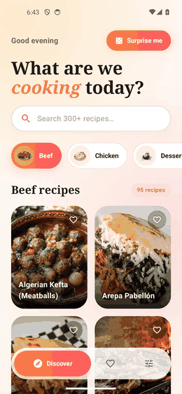
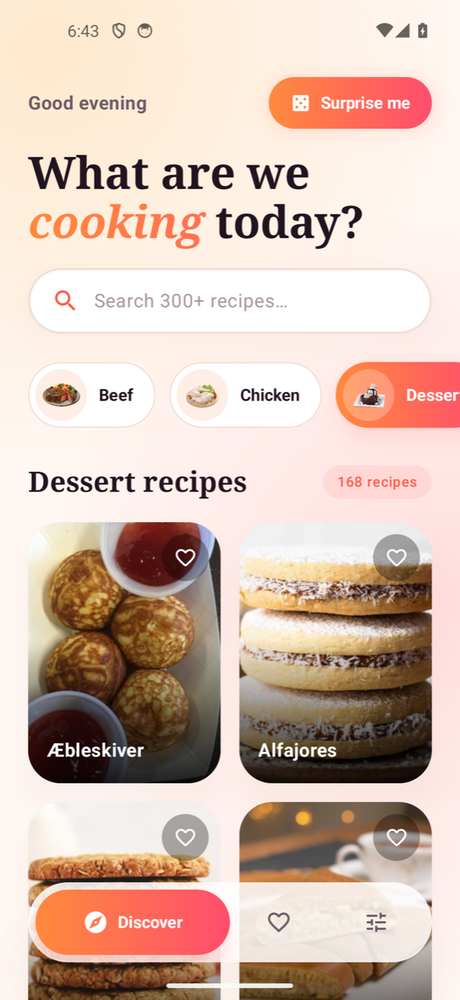
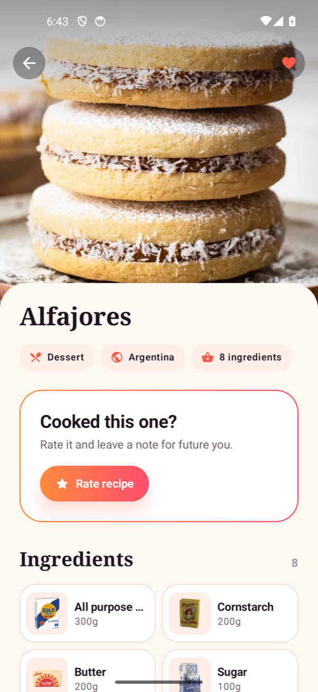
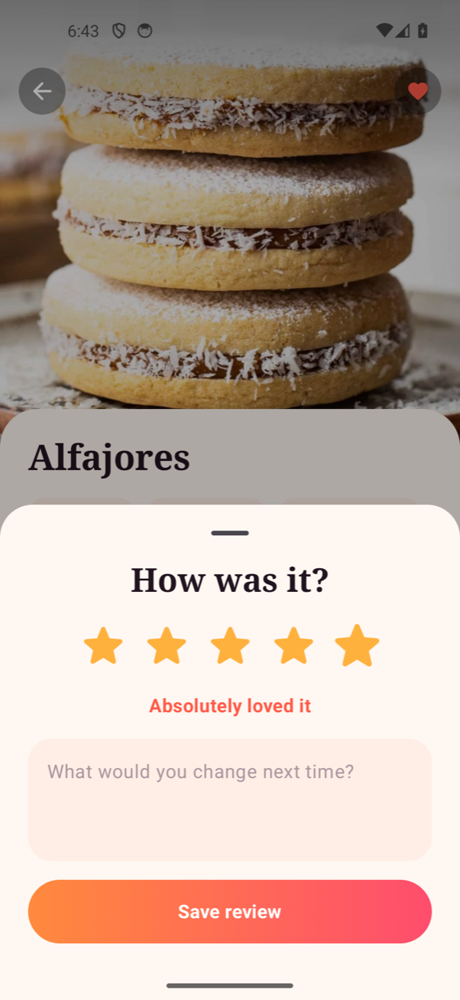

# Savora for Android

A native Android recipe explorer in Kotlin and Jetpack Compose, built as an
architecture showcase. It browses [TheMealDB](https://www.themealdb.com/api.php)
(public, no API key), lets you save recipes and rate/review them, works offline
from cache, and ships in English and Serbian with light and dark themes.

Savora exists in four stacks with the same features, design and behaviour, so
the code can be compared side by side:

| Flutter | iOS | **Android (this repo)** | React Native |
| :---: | :---: | :---: | :---: |
| [savora](https://github.com/LugonjaAleksandar/savora) | [savora-ios](https://github.com/LugonjaAleksandar/savora-ios) | Kotlin · Compose | [savora-react-native](https://github.com/LugonjaAleksandar/savora-react-native) |

## Demo

<p align="center">
  
</p>

A 20-second walkthrough recorded on a Pixel 5 emulator (Android 14), with the pauses between taps cut out. It shows the sliding category picker, the shared-element photo transition into a recipe, a 5-star review in a bottom sheet, swipe-to-remove with undo on the Saved tab, and a live switch to dark mode and Serbian. A sharper version is in [`docs/showcase.mp4`](docs/showcase.mp4).

| Discover | Recipe | Review | Settings (dark, Serbian) |
| :---: | :---: | :---: | :---: |
|  |  |  |  |

## Features

- **Discover**: category chips with a spring-animated gradient selector, a debounced search pinned under a collapsing header, a 2-column grid with staggered entrance animations, pull to refresh and a "Surprise me" random pick.
- **Recipe detail**: the photo flies from the grid or the Saved list into the header (`SharedTransitionLayout`), a parallax header, ingredient tiles, a step-by-step timeline, and YouTube/source links.
- **Rate & review**: 1–5 stars plus a note in a Material 3 bottom sheet. Stored on the device, with edit and delete.
- **Saved**: favourites persisted with their full summary, so the tab renders offline. Swipe to remove, with undo.
- **Settings**: theme (system/light/dark) and language (system/English/Srpski), both persisted. Language uses per-app locales (`AppCompatDelegate.setApplicationLocales`), so it also shows up in Android 13+ system settings. The first launch is in English.
- **Edge to edge**, a splash screen and an adaptive (themed) launcher icon.
- **Offline-first caching**: see [Caching](#caching).

## Running

Requires Android Studio with JDK 17+ and the Android 16 (API 36) SDK. The app targets Android 8.0 (API 26) and later.

```bash
./gradlew installDebug
```

Quality gates (also run in CI, see `.github/workflows/ci.yml`):

```bash
./gradlew testDebugUnitTest assembleDebug
```

Kotlin compiles with `allWarningsAsErrors`, so the build fails on any warning.

## Tech stack

| Concern | Choice |
| --- | --- |
| UI | Jetpack Compose, Material 3, Navigation Compose with type-safe routes |
| State | `ViewModel` + `StateFlow`, one-shot effects through `Channel` |
| Async | Coroutines and Flow |
| Networking | Retrofit 3 + OkHttp + kotlinx.serialization |
| Images | Coil 3 (memory and disk cache) |
| Persistence | DataStore Preferences |
| Tests | JUnit 4, kotlinx-coroutines-test, Turbine, MockWebServer |
| Build | Gradle Kotlin DSL with a version catalog (`gradle/libs.versions.toml`) |

## Architecture

Code is organised by feature. Each feature keeps its models, data access, state and UI together:

```
app/src/main/java/com/lugonja/savora/
├── app/                  # AppContainer (composition root), nav graph, home shell + tab bar
├── core/
│   ├── network/          # Outcome<T>, sealed AppFailure, safeApiCall
│   ├── storage/          # KeyValueStore interface (DataStore / in-memory)
│   ├── designsystem/     # tokens, theme, buttons, shimmer, SlidingSelector
│   └── ui/               # localized strings, shared-element and layout helpers
└── feature/
    ├── meals/            # models, Retrofit API, cache, repository
    ├── discover/         # DiscoverRoute + ViewModel, components (cards, chips, search)
    ├── detail/           # MealDetailRoute + ViewModel, components (ingredient tiles)
    ├── reviews/          # review model, repository, section and bottom sheet
    ├── favorites/        # repository, activity-scoped ViewModel, Saved route and tiles
    └── settings/         # repository, ViewModel and route
app/src/main/res/         # values/ and values-sr/ strings, generated from the shared ARB files
```

Data flows one way:

```
Composable ──intent──▶ ViewModel ──▶ Repository (interface) ──▶ Retrofit API ──▶ OkHttp
    ▲                     │                  └──────────────▶ MealsCache ──▶ KeyValueStore (DataStore)
    └── StateFlow state ──┘
```

### Key decisions

| Decision | Why |
| --- | --- |
| **Manual constructor injection from one composition root (`AppContainer`),** following the Android guide to manual DI. | No class reaches for a singleton, dependencies are visible in every constructor, and there is no annotation processing in the build. It is the same composition-root shape as the Flutter and iOS apps; Hilt would be a drop-in replacement. |
| **Repositories are interfaces; ViewModels depend only on the interface.** | Tests use fakes or in-memory storage, and swapping local storage for a backend would not touch ViewModels or UI. |
| **`Outcome<T>` + sealed `AppFailure` instead of exceptions.** | `when` over the result is exhaustive, and the UI maps failures to localised copy, never to exception messages. Cancellation is always rethrown. |
| **Immutable UI state in `StateFlow`; effects through a `Channel`.** | Screens render only from state. "Surprise me" sends `OpenMeal`, and the screen navigates, so the ViewModel never touches navigation. |
| **Restartable loads.** Every load cancels the previous job, and search waits 350 ms before hitting the network. | A slow response can never overwrite a newer selection, and typing does not fire a request per keystroke. |
| **Only route-level screens navigate.** Cards and tiles expose `onClick`; `DiscoverRoute`, `FavoritesRoute` and `MealDetailRoute` call the navigation callbacks the nav graph hands them, present the sheet and open links. | Components stay reusable and previewable, and navigation lives in one graph. |
| **List items in their own files** (`MealCard`, `CategoryChip`, `FavoriteTile`, `IngredientTile`). | Each one is easy to find, preview and reuse. |
| **The stored language is the single source of truth.** Settings writes it; `SavoraApplication` observes it and applies per-app locales. | No screen has to know how locales are applied, and the choice survives restarts on every API level. |

### Caching

`DefaultMealsRepository` uses a different strategy for each kind of data:

| Data | Strategy | TTL |
| --- | --- | --- |
| Categories | cache-first | 1 day |
| Meal detail | cache-first (also warmed by "Surprise me") | 7 days |
| Category listing | network-first, stale cache on `AppFailure.Network` | — |
| Search | network only | — |

`MealsCache` stores JSON with a timestamp in DataStore. If an entry is corrupt, it is dropped instead of crashing. Coil keeps photos in its memory and disk caches, so they render offline once seen.

### Localisation

`values/strings.xml` and `values-sr/strings.xml` are generated from the same ARB files as the Flutter app, so all four apps say exactly the same thing. Plurals cover Serbian's `one/few/other` forms ("1 recept", "3 recepta", "5 recepata"). Android picks plurals by CLDR category only, so the "exactly zero" copy is a separate `*_zero` string chosen by `quantityString`.

## Testing

23 JVM unit tests run in seconds without an emulator or network:

- `DefaultMealsRepository` against **MockWebServer** with the real Retrofit + JSON stack: query building, mapping 404/5xx/bad JSON/offline to typed failures, cache TTL hits and expiry, offline fallback, server errors not being masked by cache, cache warming by the random pick, and corrupt entries being dropped.
- `DiscoverViewModel` with a test dispatcher: initial load, category switching, **search debouncing** (only the last query reaches the repository), clearing a search, the failure path, and "Surprise me" emitting a navigation event (Turbine).
- `FavoritesViewModel`: removing emits an undoable event that restores the recipe to its position.
- Meal parsing, favourites, reviews (including rating validation) and settings persistence, including English on first launch.

## Possible next steps

- Compose UI and screenshot tests (Roborazzi) for the components.
- Room for the meal cache, with paging once the API supports it.
- Syncing reviews to a backend through a remote `ReviewsRepository`.

---

Data and images © [TheMealDB](https://www.themealdb.com).
